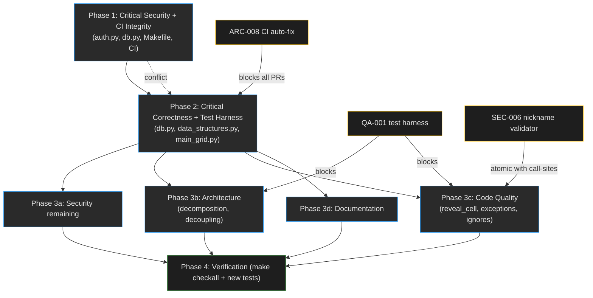

# Project Audit Report

> **Project**: Par Infinite Minesweeper (`par_infini_sweeper`)
> **Date**: 2026-07-18
> **Stack**: Python 3.11–3.13 · Textual TUI · textual-serve (web mode) · SQLite3 · OAuth2/Auth0 leaderboard · pydantic · orjson · typer · hatchling
> **Size**: ~3,167 LOC across 26 Python files in `src/par_infini_sweeper/`
> **Audited by**: Claude Code Audit System (4 parallel expert agents + source-verified synthesis)

---

## Executive Summary

Par Infinite Minesweeper is a well-tooled, cleanly-linted Textual TUI with a genuinely mature release pipeline (4-stage CI, Sigstore signing, OIDC trusted publishing) and solid fundamentals — parameterized SQL, TLS-everywhere, pre-commit secret scanning, a thoughtful dirty-flag incremental-save design. **The hygiene is real; the correctness is not.** Three shipped Critical gameplay/data bugs — a reversed high-score query, a `TypeError` crash on any unrecognized username, and a first-click "safety" that scrubs mines from the entire opening flood-fill region — went undetected because **the project has zero tests**, and a fourth logic bug inverts OAuth token-expiry enforcement. The OAuth2 leaderboard client has real gaps (no PKCE, plaintext long-lived refresh tokens, exception text leaked to the loopback callback), and the project's flagship feature is hidden behind an undocumented hotkey. Estimated effort to clear the Criticals + stand up a test harness: **1–2 focused days**; full remediation (decompose the 865-LOC god module, harden auth, write docs) is roughly **2–3 weeks of part-time work**.

### Issue Count by Severity

| Severity | Architecture | Security | Code Quality | Documentation | Total |
|----------|:-----------:|:--------:|:------------:|:-------------:|:-----:|
| 🔴 Critical | 2 | 0 | 2 | 2 | **6** |
| 🟠 High     | 7 | 3 | 6 | 4 | **20** |
| 🟡 Medium   | 10 | 3 | 6 | 5 | **24** |
| 🔵 Low      | 8 | 3 | 8 | 8 | **27** |
| **Total**   | **27** | **9** | **22** | **19** | **77** |

*Several findings are cross-domain duplicates (the god module, the static API key, import-time side effects appear in multiple agents' lists). These are cross-referenced with **≡** and counted once conceptually; the table counts each agent's report row.*

---

## 🔴 Critical Issues (Resolve Immediately)

### [ARC-001] `get_user()` crashes on any unrecognized username
- **Area**: Architecture / Correctness
- **Location**: `src/par_infini_sweeper/db.py:189-198`
- **Description**: `user = dict(cursor.fetchone())` runs before the `None` check. `fetchone()` returns `None` when no row matches, and `dict(None)` raises `TypeError` — so the `if user is None: init_db(...)` self-heal branch is **unreachable**. The fallback also hardcodes `"user"` instead of the requested `username`.
- **Impact**: A first-time username, a typo, or any missing user row crashes the app on startup instead of provisioning the user. This affects every new install path.
- **Remedy**:
  ```python
  row = cursor.fetchone()
  if row is None:
      init_db(conn, username, nickname)
      cursor.execute("SELECT * FROM users WHERE username = ?", (username,))
      row = cursor.fetchone()
  user = dict(row)
  ```
- **Verified**: Yes — confirmed by direct source read.

### [ARC-002] `get_highscores()` returns the 10 *oldest* scores, not the 10 *highest*
- **Area**: Architecture / Correctness
- **Location**: `src/par_infini_sweeper/db.py:210-216`
- **Description**: `SELECT * FROM highscores WHERE game_id=? AND user_id=? order by created_ts limit 10` orders ascending by timestamp with no `DESC` and no `score` ordering. The `LIMIT 10` therefore picks the **earliest** 10 finishes.
- **Impact**: The local high-score tab in `HighscoreDialog` shows the user's first 10 games ever and never surfaces a new top score once they've played >10 games. The headline feature is silently broken.
- **Remedy**: `ORDER BY score DESC, created_ts DESC LIMIT 10`. Add a regression test inserting 12 distinct scores and asserting order.
- **Verified**: Yes — confirmed by direct source read.

### [QA-001] Zero test coverage — no test suite exists anywhere
- **Area**: Code Quality
- **Location**: `Makefile:85-87` (`test` target prints `"No tests configured yet"`), `.github/workflows/build.yml` (runs `make checkall` only — no test step), no `tests/` directory
- **Description**: `find` for `test_*.py` / `*_test.py` / `tests/` returns nothing. There are no tests for any game logic — first-click safety, flood fill, mine counts, scoring, win/lose, subgrid-solved detection, save/load round-trip, or DB migrations. The CI workflow is named "Build and Test" but contains no test step.
- **Impact**: This is the **root cause** that let ARC-001, ARC-002, and QA-002 ship in tagged releases. Every future refactor of the god module or auth flow is a coin flip.
- **Remedy**: Add `pytest` + `pytest-asyncio` to dev deps; create `tests/`; start with regression tests for the three Critical bugs plus `SubGrid.generate_cells` mine-count/distribution, `check_subgrid_solved`, `to_dict`/`from_dict` round-trips, and `db_migrations` upgrade paths. Wire `pytest` into the `test` Make target, add `test` to `checkall`, and add a test step to `build.yml`.

### [QA-002] First-click "safety" scrubs mines from the entire opening flood-fill
- **Area**: Code Quality / Gameplay correctness
- **Location**: `src/par_infini_sweeper/main_grid.py:130-131` + `src/par_infini_sweeper/data_structures.py:640-663`
- **Description**: In `MainGrid.handle_click`, the call order is:
  ```python
  self.game_state.reveal_cell(gx, gy)    # recursive flood fill runs with first_click still True
  self.game_state.first_click = False    # flag cleared only AFTER recursion returns
  ```
  Inside `reveal_cell`, any mine encountered is relocated (not game-over) while `self.first_click` is True. Because the flag stays True for the **entire** opening recursion, every mine bordering the opened empty region is silently moved, not just the clicked cell.
- **Impact**: The opening clears itself of all adjacent mines, making the game materially easier than designed and firing the "safety" protection on far more than one cell. This breaks the core mechanic.
- **Remedy**: Clear `first_click` at the top of `reveal_cell` on the entry call (guard with `depth == 0`), before any recursion. Cover with a unit test that places a known mine inside the flood region and asserts the game ends.
- **Verified**: Yes — confirmed by direct source read of both the call site and the recursion.

### [DOC-001] The internet-leaderboard feature is hidden behind an undocumented hotkey
- **Area**: Documentation
- **Location**: `README.md:52-61` (Controls) and `src/par_infini_sweeper/help.md:17-26` (Controls); binding at `src/par_infini_sweeper/pim_app.py:58`
- **Description**: The `a` key binding (`Binding(key="a", action="auth", description="Authentication")`) is the **only** way to open the AuthDialog for login / nickname reservation / score upload. It is listed in neither the README nor the in-app help Controls section — even though README "Whats New" v0.3.0 announces it. The AuthDialog itself dead-ends users with "See the Readme or full help".
- **Impact**: New users cannot discover how to log in or submit scores. The project's primary differentiator is effectively hidden.
- **Remedy**: Add `* A — Authentication / Internet Leaderboard (login, register nickname, upload score)` to both Controls lists.

### [DOC-002] Documented nickname length limit (30) contradicts enforced limit (20)
- **Area**: Documentation
- **Location**: `README.md:182` vs `src/par_infini_sweeper/__main__.py:40-45` and `src/par_infini_sweeper/db.py:64-68`; inconsistent inside the codebase at `models.py:26,35` and `dialogs/login_dialog.py:185-187` (which allow 30)
- **Description**: README says "Limit username and nickname to no more than 30 characters", but the CLI and DB reject values over **20**. The CLI Options block documents neither the existence nor the value of the limit. The codebase is itself inconsistent: the net-nickname paths still allow 30.
- **Impact**: `pim --nick <25-char-name>` fails with an opaque error contradicting the changelog; local vs. net nickname caps diverge.
- **Remedy**: Pick one canonical limit (recommend 20, which the gate enforces), update README, add the limit to the CLI Options listing, and reconcile `models.py`/`login_dialog.py`.

---

## 🟠 High Priority Issues

### [SEC-001] OAuth2 authorization-code flow is missing PKCE (public client)
- **Area**: Security
- **Location**: `src/par_infini_sweeper/auth.py:80-82, 97`
- **Description**: `create_authorization_url` is called without a `code_verifier`, so no `code_challenge`/`code_challenge_method=S256` is sent and `fetch_token` includes no `code_verifier`. This is a public native/desktop client — exactly the case OAuth 2.0 BCP #1 and OAuth 2.1 make PKCE mandatory for.
- **Impact**: Anyone who can observe the authorization code (browser history, a malicious local process reading the loopback request, a custom-scheme interloper) can redeem it at the token endpoint. `state` protects only against CSRF, not code interception.
- **Remedy**: Generate `code_verifier = secrets.token_urlsafe(64)` before `create_authorization_url`; pass `code_verifier=` into both `create_authorization_url` and `fetch_token`. Auth0 supports PKCE on all public clients.

### [SEC-002] OAuth tokens stored in plaintext SQLite with no file-permission hardening
- **Area**: Security
- **Location**: `src/par_infini_sweeper/db.py:39-48, 97-100` (columns `id_token`, `access_token`, `refresh_token`); backup at `db.py:42`
- **Description**: `access_token`, `refresh_token`, and `id_token` are stored as plain TEXT in `game_data.sqlite`. Neither the DB nor its `.bak` is created with restrictive permissions; the `refresh_token` is long-lived (`offline_access` scope, `auth.py:40`).
- **Impact**: Any local user who can read the file can impersonate the victim against the leaderboard (mint fresh access tokens via `grant_type=refresh_token`) until revoked. Meaningful on shared/multi-user hosts.
- **Remedy**: `os.chmod(db_path, 0o600)` and `os.chmod(db_bak_path, 0o600)` after creation; `db_folder.mkdir(..., mode=0o700)`. Better: move `refresh_token` to the OS keychain (`keyring`).

### [SEC-003] Raw exception text leaked to anyone reaching the loopback callback
- **Area**: Security
- **Location**: `src/par_infini_sweeper/auth.py:107-109`
- **Description**: `except Exception as e: self.send_error(500, str(e))` returns the raw exception string in the HTTP response body — `fetch_token` failures, Auth0 error descriptions, and authlib internals.
- **Impact**: Any web page the user visits can redirect to `http://127.0.0.1:1999/oauth/callback?code=garbage` and fingerprint the auth setup via the error body. (Downgraded from Critical because the listener is on `127.0.0.1`.)
- **Remedy**: `self.send_error(500, "Authentication failed")`; log `repr(e)` to stderr/file only.

### [ARC-003] `is_logged_in()` has inverted token-expiry semantics ≡ SEC-007
- **Area**: Architecture / Correctness
- **Location**: `src/par_infini_sweeper/data_structures.py:316-320`
- **Description**: `is_expired = time_remaining > grace_time` is True when the token is *healthy*, not when expired. Because `offline_access` is always requested, most users carry a refresh token and the function collapses to "always True" — i.e. **no expiry enforcement at all**.
- **Impact**: Stale/expired access tokens aren't detected; the UI gates Upload-Score/Change-Nickname on refresh-token presence rather than access-token validity. (Limited blast radius — the leaderboard server still validates tokens.)
- **Remedy**: `is_expired = time_remaining <= grace_time; return (not is_expired) or bool(self.user.get("refresh_token"))`, with a test driving expiring and non-expiring tokens.
- **Note**: Architecture rated Critical, Security rated Medium; **High** reflects a real logic bug with bounded server-side impact.

### [ARC-004] God module: `data_structures.py` (865 LOC) mixes 4 concerns ≡ QA-005
- **Area**: Architecture
- **Location**: `src/par_infini_sweeper/data_structures.py` (whole file)
- **Description**: `Cell`, `SubGrid`, and `GameState` are crammed into one file. `GameState` does game logic, persistence, OAuth/leaderboard HTTP, input handling, **and** rendering (emitting Rich markup with hardcoded hex colors; calling `self.parent.notify()`/`self.parent.refresh()` directly). `Cell.highlighted.setter` even reaches `self.parent.parent.highlighted_cells`.
- **Impact**: Violates SRP/DIP. The model can't be tested without SQLite + Auth0 + a Textual widget + `os.environ`. Every change risks cross-cutting breakage.
- **Remedy**: Decompose into `game/` (pure model, no I/O), `persistence/` (`GameRepository`), `leaderboard/` (`OAuthLeaderboardClient`), and a `renderer.py`. Inject dependencies; emit Textual `Message`s instead of calling parent methods.

### [ARC-005] Model ↔ UI bidirectional coupling
- **Area**: Architecture
- **Location**: `src/par_infini_sweeper/main_grid.py:31, 143-144`
- **Description**: `MainGrid.__init__` sets `game_state.parent = self` so the model can call UI methods; `adjust_mouse_pos` mutates private Textual attributes `event._x`/`event._y` on every mouse event.
- **Impact**: The model only runs inside a Textual widget (no headless reuse); mutating `_x`/`_y` will silently break on a Textual upgrade.
- **Remedy**: Widget owns mouse-to-grid conversion and emits `Message`s; replace `self.parent.notify/refresh` with a callback/Message; compute the offset into a local instead of mutating `event._x`.

### [ARC-006] `get_db_connection()` runs a full backup check on every connection open
- **Area**: Architecture / Performance
- **Location**: `src/par_infini_sweeper/db.py:34-50`
- **Description**: Every caller stats the DB and backup, compares mtimes, and periodically `read_bytes`/`write_bytes` the whole file. `get_db_connection` is called on every `save()`, `save_score()`, `load()`, `save_user()`, `logout()`, `new_game()`.
- **Impact**: For an infinite game that saves on every cell click, this is significant per-click I/O and latency.
- **Remedy**: Hoist the backup to a single daily check at app startup / `on_mount`; never inside `get_db_connection`.

### [ARC-007] Module-level side effects on import ≡ QA-010
- **Area**: Architecture
- **Location**: `src/par_infini_sweeper/db.py:19-30` (mkdir + legacy rename at import), `src/par_infini_sweeper/__init__.py:7-9,20,22` (`load_dotenv()`, imports `PimApp`, writes `os.environ["USER_AGENT"]`)
- **Description**: Importing `par_infini_sweeper` for any reason triggers filesystem mutation, env writes, and pulls in every dependency.
- **Impact**: Primary blocker to adding unit tests; two `pim` processes race the legacy rename.
- **Remedy**: Move dir setup into `db.init_storage()` called lazily; move `load_dotenv()`/`USER_AGENT` into `__main__.main()`; stop re-exporting `PimApp` from `__init__`.

### [ARC-008] `make checkall` silently auto-fixes files during CI
- **Area**: Architecture / CI integrity
- **Location**: `Makefile:69-90` (`lint` runs `ruff check --fix`, `format` runs `ruff format`; `checkall: format lint typecheck`)
- **Description**: CI's `make checkall` rewrites files before typecheck. If the rewrite differs from the commit, CI validates a tree that doesn't match the commit.
- **Impact**: A green build can hide lint failures. Should land before code-quality PRs so they're validated honestly.
- **Remedy**: Split into `lint-check` (`ruff check`) and `format-check` (`ruff format --check`) for CI; keep fix-applying variants for local use only.

### [ARC-009] Static obfuscated "API key" committed to source ≡ QA-003 ≡ SEC-009 — **MANUAL / OPT-IN**
- **Area**: Security / Hygiene
- **Location**: `src/par_infini_sweeper/db.py:282-284`
- **Description**: `headers = {"api-key": base64.b64decode("V29vdFdvb3RXb290").decode()}` decodes to the literal `"WootWootWoot"`. The adjacent comment admits "yes i know this is bad". Base64 is not encryption; it ships plaintext in the wheel and on PyPI. gitleaks missed it (constructed at runtime).
- **Impact**: Disagreement across agents: Code Quality called it Critical (committed secret), Architecture High (security theater), Security Low (anti-bot only; real protection is server-side). **Net: it is a leaked credential in source control that deters only naive bots.**
- **Remedy**: ⚠️ **Per project security policy, key rotation/externalization is opt-in and must be done manually — do not auto-rotate.** Move to an env var via `python-dotenv`, rotate the leaked value, and consider dropping the header entirely in favor of the existing OAuth bearer token. Flag for manual review before committing.

### [QA-003] `reveal_cell` has Critical cyclomatic complexity (28) + magic depth cap
- **Area**: Code Quality
- **Location**: `src/par_infini_sweeper/data_structures.py:617-688`
- **Description**: par-mem rates this method Critical (complexity 28). It mixes first-click relocation, neighbor generation, mine counting, depth-bounded recursion, and subgrid-solve checks. The `if depth < 250` cap is a magic number that silently leaves a partially revealed region on large empty areas.
- **Remedy**: Convert flood fill to an explicit BFS stack with a visited set (no depth cap, no recursion-limit risk); extract mine-relocation to its own method; promote `250` → `MAX_REVEAL_DEPTH`.

### [QA-004] Bare `except Exception` swallowed throughout (8 sites)
- **Area**: Code Quality
- **Location**: `data_structures.py:321`, `auth.py:61`, `pim_app.py:149-150`, `dialogs/highscore_dialog.py:83`, `dialogs/login_dialog.py:83,170,194`
- **Description**: Eight broad-except blocks; several discard the exception entirely (e.g. `except Exception as _: pass` around webserver shutdown; token-refresh errors silently blank tokens).
- **Impact**: Failures are invisible — a network error looks identical to a bad refresh token; webserver shutdown failures make port-reuse issues impossible to diagnose.
- **Remedy**: Catch specific exceptions (`requests.RequestException`, `jose.JWTError`, `sqlite3.Error`); `logging.exception` before deciding to swallow; define a `PimError` hierarchy.

### [QA-005] `type: ignore[reportAttributeAccessIssue]` masks real type errors
- **Area**: Code Quality
- **Location**: `src/par_infini_sweeper/data_structures.py:360, 852`
- **Description**: `self.auth_client.post(...)` is annotated `# type: ignore[reportAttributeAccessIssue]` because `auth_client` is `OAuth2Session | None` but the property claims non-optional.
- **Remedy**: Add authlib type stubs or wrap in a helper returning `requests.Response`; remove the ignores. Undermines the `Typing :: Typed` classifier.

### [QA-006] Editor backup `pyproject.toml~` committed to repo
- **Area**: Code Quality / Hygiene
- **Location**: `pyproject.toml~` (root)
- **Remedy**: `git rm pyproject.toml~`; add `*~` to `.gitignore`.

### [DOC-003] No `CHANGELOG.md`; version history buried and partly wrong in README
- **Area**: Documentation
- **Location**: Missing `CHANGELOG.md`; history at `README.md:150-212`
- **Description**: Two duplicate `Version 0.2.6:` entries; typo "Addata game data backup" (v0.2.8); the 30-char claim (DOC-002); unsorted prose mixing user-facing changes with housekeeping.
- **Remedy**: Move to `CHANGELOG.md` in Keep-a-Changelog format; fix the duplicates/typos during migration.

### [DOC-004] Undocumented environment variables
- **Area**: Documentation
- **Location**: Variables in `auth.py:16-17`, `db.py:281`, `data_structures.py:358,850`; `.env:1`
- **Description**: `PIM_LEADERBOARD_URL`, `AUTH0_DOMAIN`, `AUTH0_CLIENT_ID`, `USER` are read but never documented. The `.env` ships only a commented hint.
- **Remedy**: Add a Configuration section / `docs/CONFIGURATION.md` listing each var, default, purpose, example.

### [DOC-005] OAuth provider list inconsistent between docs and the dialog
- **Area**: Documentation
- **Location**: `README.md:81`, `help.md:41` ("google or facebook") vs `dialogs/login_dialog.py:119` ("Google, Facebook, Github")
- **Remedy**: Update both docs to "Google, Facebook, or GitHub".

### [DOC-006] `--server` flag omits web-port and browser-access details
- **Area**: Documentation
- **Location**: `README.md:138`
- **Description**: `--server/-s` launches `textual-serve` over HTTP, but the README gives no URL/port, no browser instruction, and no note on the collision with the OAuth callback port (1999).
- **Remedy**: Add a "Web Server Mode" subsection with the listen URL/port and an example.

---

## 🟡 Medium Priority Issues

**Architecture**: ARC-010 `init_db(conn)` misleading optional signature (`db.py:53,70`); ARC-011 `get_user` writes nickname on every read (`db.py:197-198`); ARC-012 `auth.build_auth_client` uses obscure `is_expired() in [None, True]` (`auth.py:45`) and large `start_auth_server`; ARC-013 `update_info` derives `duration` from a UI timer that fires regardless of focus — desyncs on pause/sleep (`main_grid.py:46-74`); ARC-014 dead code + no-op self-assignment `self.game_state.offset = self.game_state.offset` (`main_grid.py:200`) and commented blocks; ARC-015 `reveal_cell` `border_cell` shadowing (`data_structures.py:650/659`); ARC-016 dialog boilerplate duplicated across 12 dialogs despite an existing `TextDialog` base; ARC-017 `PimApp.__init__` does heavy sync DB I/O before the event loop (`pim_app.py:63-76`); ARC-018 hardcoded OAuth callback port 1999 with no `SO_REUSEADDR`/collision handling ≡ QA (`auth.py:19,121`); ARC-019 hardcoded Auth0 client ID means local dev hits production auth by default (`auth.py:17`).

**Security**: SEC-004 `Host` header reflected into `authorization_response` (`auth.py:96`); SEC-005 loose `startswith("/oauth/callback")` match with no early `return` (`auth.py:92-93`); SEC-006 inconsistent nickname validation — 20 vs 30 char, **no charset check** anywhere despite the README promise (`__main__.py`, `db.py`, `login_dialog.py`, `models.py`) → stored display-spoof/XSS risk in other clients.

**Code Quality**: QA-007 `assert` used for runtime validation (stripped under `-O`) (`data_structures.py:237,301,629,721,749,772`); QA-008 8-neighbor loop duplicated 7× (`data_structures.py`); QA-009 copy-paste docstring `"""Par LLAMA TUI dialogs package."""` (`dialogs/__init__.py:1`); QA-010 `compute_board_center` divides by `len(self.subgrids)` (ZeroDivisionError) + unexplained `+5/-3` (`data_structures.py:398-404`); QA-011 `# noqa: F821` silencers on `GameState` params in 4 dialogs (hides a real import/typing issue); QA-012 `.pre-commit-config.yaml` runs Python 3.12 while the project targets 3.13.

**Documentation**: DOC-007 no `CONTRIBUTING.md` despite README invitation; DOC-008 no architecture / DB-schema documentation (SQLite schema, migration story, infinite-board generation, OAuth flow all undocumented); DOC-009 no troubleshooting/FAQ for the port-1999 firewall warning; DOC-010 no release/operations documentation (4-stage CI pipeline undocumented); DOC-011 in-app `help.md` omits the Storage section and the critical "post score before new game" warning.

---

## 🔵 Low Priority / Improvements

**Architecture**: ARC-020 stray `pyproject.toml~` (≡ QA-006); ARC-021 stale docstrings (`HighscoreDialog` "Base modal dialog for showing information"); ARC-022 `PimApp(App)` missing the recommended generic param (`App[None]`); ARC-023 duplicated `USER` env fallback (`__main__.py:31`, `pim_app.py:64-65`); ARC-024 magic numbers without constants (depth `250`, `set_timer(300,...)`, port `1999`); ARC-025 CI tests only Python 3.13 despite `requires-python>=3.11`; ARC-026 `pyrightconfig.json` ships unused `defineConstant: { DEBUG: true }`; ARC-027 `ruff.toml` ignores `E501` redundantly (`line-length=120` already set).

**Security**: SEC-008 DB backup file written without restrictive modes (fold into SEC-002); SEC-009 migration silently truncates nicknames to 30 on every startup (`db.py:89`); SEC-010 `--server` mode exposes the TUI localhost-only without auth — document and warn.

**Code Quality**: QA-013 `MainGrid` passes `compute_board_center`'s `+5/-3` as magic args; QA-014 commented-out code blocks (`main_grid.py:169-175`, `highscore_dialog.py:108,126,173-178`); QA-015 `save_score` silently returns on `score==0` (deserves a docstring); QA-016 `GameState.user` is a shared mutable dict — replace with a Pydantic `User` model; QA-017 `escape_brackets` reinvents Textual's `Text.from_markup`/`escape=True`; QA-018 duration timer runs while the window is unfocused; QA-019 `Cell.from_dict` does no key check → `KeyError` on corrupt rows; QA-020 dead `PimApp.set_debug` (`pim_app.py:109`).

**Documentation**: DOC-012 badge alt-text typo "x86-63" (`README.md:6`); DOC-013 duplicate Scoring sentence + grammar slip (`README.md:66,71`); DOC-014 no build-status badge; DOC-015 no CLI usage examples; DOC-016 roadmap is two vague stalled bullets; DOC-017 `.aider.conventions.md` says "assume python 3.12" (project is 3.13); DOC-018 docstring coverage moderate and inconsistent vs. declared Google-style; DOC-019 no `SECURITY.md` / `CODE_OF_CONDUCT.md`.

---

## Detailed Findings

### Architecture & Design
The codebase is well-packaged (clean `uv.lock`, correct hatchling `dynamic = ["version"]` from `__init__.py`, deliberate sdist/wheel includes) with a **genuinely mature release pipeline**: a four-stage chain (`build` → `publish-dev` to TestPyPI → `publish` to PyPI → `release` to GitHub), Sigstore signing of wheels/sdists, OIDC trusted publishing (`id-token: write`, no long-lived PyPI tokens), and build-artifact caching. The SQLite migration story is sound (`db_migrations.py`, forward-only gated by `pim_db_info.version`, legacy `~/.pim` → XDG relocation). `to_dict`/`from_dict` round-trips are explicit (orjson) and the `changed`-flag propagation enables incremental saves — a sensible design for an unbounded board.

The core problems are **structural concentration and import-time coupling**. `GameState` is a god object fusing game logic, persistence, auth/network, and rendering, and it reaches into its `parent` widget. `db.py` and `__init__.py` perform filesystem/env side effects at import, which is the single largest obstacle to adding tests. `make checkall` applies fixes during CI, undermining build integrity. Three Critical correctness bugs live in `db.py`/`data_structures.py` (ARC-001, ARC-002, ARC-003). Full detail in the per-issue entries above.

### Security Assessment
Hygiene is strong: SQL is **fully parameterized** everywhere (no f-string/format SQL); no `eval`/`exec`/`pickle`/`subprocess`/`verify=False`/weak-hash usage; TLS is never disabled and all endpoints are HTTPS; network calls carry explicit timeouts; pre-commit runs `gitleaks` + `detect-private-key`; publishing uses OIDC; `.env` is gitignored, contains no secrets (one commented line), and is **not** packaged into the wheel; dependency versions are current (python-jose 3.5.0 post-CVE, authlib 1.7.2, cryptography 49.0.0, pydantic 2.13.4).

The gaps cluster in the **OAuth2 native-client implementation**: no PKCE (SEC-001), plaintext long-lived refresh tokens with no file-mode hardening (SEC-002), raw exception text leaked from the callback handler (SEC-003), a reflected `Host` header (SEC-004), and a loose callback path match (SEC-005). The OAuth `state` CSRF concern raised by code-quality review was **investigated and refuted**: `authlib.integrations.requests_client.OAuth2Session.fetch_token` validates `state` internally (`MismatchingStateException`) via `parse_authorization_code_response` — so classic callback CSRF is blocked. The code does not persist `state` explicitly, which is fragile; recommend passing `state=` explicitly to `fetch_token` as defense-in-depth (Low). Nickname validation is inconsistent and lacks the promised charset check (SEC-006).

### Code Quality
Lint and type checks pass cleanly (`ruff check`: "All checks passed!"; `pyright`: "0 errors, 0 warnings") and are enforced via pre-commit. SQL is parameterized; Pydantic v2 DTOs with `Field` constraints form a clean leaderboard API boundary; `StrEnum` + SQLite CHECK constraints self-validate persistence; the dirty-flag incremental save is thoughtful.

The dominant finding is **zero test coverage** (QA-001), which let the three Critical correctness bugs ship. Beyond that: a confirmed first-click flood-fill gameplay bug (QA-002), the 865-LOC god module (QA-005 ≡ ARC-004), a Critical-complexity `reveal_cell` with a magic depth cap (QA-003), eight swallowed broad-except blocks (QA-004), `type: ignore` masking real type errors (QA-005), and assorted hygiene noise (`pyproject.toml~`, copy-paste "Par LLAMA" docstring, `assert` for runtime checks, 7× neighbor-loop duplication, `# noqa: F821` silencers). No TODO/FIXME/HACK markers; pylint-disables are inert (pylint isn't configured). One genuinely dead symbol confirmed: `PimApp.set_debug`.

### Documentation Review
The README's gameplay sections (Objective, Controls, Scoring) are well-written and **accurate against the implementation** — difficulty mine counts (8/12/16) match `data_structures.py:26`, and first-click-safe, drag-to-pan, shift+click chord behavior all match. `data_structures.py` has good Google-style docstrings on its public methods (a model for the rest of the codebase). `pyproject.toml` metadata is complete and correct; issue templates are thoughtfully structured.

The gaps: the `a` auth key is undocumented (DOC-001) — hiding the flagship leaderboard feature; a 30-vs-20-char doc/code contradiction (DOC-002); no `CHANGELOG.md` with several factual errors in the inline history (DOC-003); undocumented env vars (DOC-004); inconsistent OAuth provider list omitting GitHub (DOC-005); bare `--server` docs (DOC-006); and no CONTRIBUTING/architecture/release/troubleshooting docs. Numerous small errors (alt-text typo, duplicate Scoring sentence, `.aider.conventions.md` Python version drift, no build badge).

---

## Remediation Roadmap

### Immediate Actions (Before Next Deployment)
1. **ARC-002** — add `DESC` to the highscores query (one-line fix; leaderboard is currently wrong).
2. **ARC-001** — guard `get_user` against `None` (one-line fix; crashes new users).
3. **QA-002** — move `first_click = False` to the top of the entry `reveal_cell` call (fixes the core gameplay mechanic).
4. **ARC-003** — invert `is_logged_in` expiry check.
5. **ARC-008** — stop `make checkall` from auto-fixing in CI (so the fixes above are validated honestly).
6. Stand up the test harness (QA-001) with regression tests for the four bugs above.

### Short-term (Next 1–2 Sprints)
7. **SEC-001/002/003/004/005** — PKCE, token file-perm hardening, exception-leak fix, callback hardening.
8. **SEC-006** — centralize nickname validation (single regex, one length cap) across all 5 call sites.
9. **ARC-009** — externalize the static API key (⚠️ manual/opt-in; rotate the leaked value).
10. **DOC-001/002/005/006/011** — document the `a` key, fix the char-limit, resync OAuth providers, document `--server`, mirror Storage into `help.md`.
11. **ARC-007** — eliminate import-time side effects (unblocks testing).

### Long-term (Backlog)
12. **ARC-004/005** — decompose `data_structures.py` into game/persistence/leaderboard/renderer modules; decouple model from UI via Messages.
13. **QA-003** — rewrite `reveal_cell` flood fill as iterative BFS; extract mine-relocation.
14. **ARC-006** — hoist DB backup to once-per-launch.
15. **QA-004/005** — replace broad-except with specific exceptions; remove `type: ignore`.
16. **DOC-003/008/010** — add `CHANGELOG.md`, `docs/ARCHITECTURE.md`, `docs/RELEASE.md`.
17. CI Python-version matrix (3.11/3.12/3.13); the Low-severity cleanup list.

---

## Positive Highlights

1. **Release pipeline is exemplary** — 4-stage build → TestPyPI → PyPI → GitHub Release, Sigstore signing, OIDC trusted publishing (no long-lived tokens), artifact caching. The most mature part of the project.
2. **SQL is fully parameterized** across `db.py`, `db_migrations.py`, and `data_structures.py` — no injection surface.
3. **No dangerous Python patterns** — no `eval`/`exec`/`pickle`/`subprocess`/`shell=True`/`verify=False`; TLS never disabled; all endpoints HTTPS; explicit network timeouts.
4. **Clean lint and types** — `ruff` and `pyright` both pass cleanly, enforced via pre-commit with `gitleaks` + `detect-private-key`.
5. **Thoughtful incremental-save design** — `Cell.changed`/`SubGrid.changed` propagation to `GameState.changed_subgrids` writes only dirty subgrids, ideal for an unbounded board.
6. **Strong data integrity** — `StrEnum` difficulties/modes + SQLite CHECK constraints self-validate; explicit orjson `to_dict`/`from_dict` round-trips.
7. **Excellent docstrings on the core model** — `data_structures.py` public methods carry real Google-style Args/Returns docstrings.
8. **Accurate gameplay docs** — README difficulty mine counts and controls match the implementation exactly; well-structured issue templates.

---

## Audit Confidence

| Area | Files Reviewed | Confidence |
|------|---------------|-----------|
| Architecture | 26 source + config/CI/Makefile | **High** — all source read directly; correctness bugs source-verified |
| Security | 26 source + `.env`, `pyproject.toml`, `uv.lock`, CI, pre-commit | **High** — auth flow traced into authlib internals |
| Code Quality | 26 source + Makefile/ruff/pyright config | **High** — lint/typecheck run; complexity from par-mem analytics |
| Documentation | README, help.md, `.aider.conventions.md`, all docstrings, CI | **High** — all claims checked against source |

*Note: the par-mem code graph for this repo failed to complete (`sqlite error: database is locked` at the embedding stage — collateral damage from a concurrent unrelated index job). All four agents fell back to direct Glob/Grep/Read and par-mem's read-side analytics that had already emitted; audit quality is unaffected. A second par-mem pass with `find_central_symbols`/`find_bridge_symbols` after a clean reindex would quantitatively confirm the coupling analysis.*

---

## Remediation Plan

> Generated by `/audit` and consumed directly by `/fix-audit`. Pre-computes phase assignments and file conflicts so the fix orchestrator proceeds without re-analyzing the codebase.

### Phase Assignments

#### Phase 1 — Critical Security & CI Integrity (Sequential, Blocking)
<!-- Security issues promoted here because they modify conflict files also targeted by Code Quality (auth.py, db.py, data_structures.py, models.py). -->
| ID | Title | File(s) | Severity |
|----|-------|---------|----------|
| SEC-001 | Add PKCE to OAuth2 flow | `src/par_infini_sweeper/auth.py` | High |
| SEC-002 | Harden token storage (chmod 0600/0700; keychain for refresh_token) | `src/par_infini_sweeper/db.py` | High |
| SEC-003 | Stop leaking exception text from callback | `src/par_infini_sweeper/auth.py` | High |
| SEC-004 | Hardcode `authorization_response` host; reject forged Host | `src/par_infini_sweeper/auth.py` | Medium |
| SEC-005 | Exact callback path match + early `return` | `src/par_infini_sweeper/auth.py` | Medium |
| SEC-006 | Centralize nickname validator (regex + one length cap) | `__main__.py`, `db.py`, `dialogs/login_dialog.py`, `models.py` | Medium |
| ARC-009 | Externalize static API key ⚠️ **MANUAL / opt-in — do not auto-rotate** | `src/par_infini_sweeper/db.py` | High |
| ARC-008 | Stop `make checkall` auto-fixing in CI (add `lint-check`/`format-check`) | `Makefile`, `.github/workflows/build.yml` | High |

#### Phase 2 — Critical Correctness + Test Harness (Sequential, Blocking)
<!-- The shipped correctness bugs, fixed as surgical edits, with a test harness landed alongside so regressions are caught and the Phase 3 decomposition is safe. -->
| ID | Title | File(s) | Severity | Blocks |
|----|-------|---------|----------|--------|
| ARC-002 | Fix highscores `ORDER BY score DESC` | `src/par_infini_sweeper/db.py` | Critical | — |
| ARC-001 | Guard `get_user` against `None` | `src/par_infini_sweeper/db.py` | Critical | — |
| QA-002 | Clear `first_click` before flood-fill recursion | `main_grid.py`, `data_structures.py` | Critical | — |
| ARC-003 | Invert `is_logged_in` expiry check | `src/par_infini_sweeper/data_structures.py` | High | — |
| QA-001 | Add pytest harness + regression tests; wire `test` target + CI | `Makefile`, `build.yml`, new `tests/` | Critical | ARC-004, QA-003 |

#### Phase 3 — Parallel Execution
<!-- All remaining work, safe to run concurrently by domain — EXCEPT files in the Conflict Map below, which /fix-audit must sequence (read-before-edit) because multiple domains touch them. -->

**3a — Security (remaining)**
| ID | Title | File(s) | Severity |
|----|-------|---------|----------|
| SEC-008 | Restrict DB backup file mode | `src/par_infini_sweeper/db.py` | Low |
| SEC-009 | Warn (don't silently truncate) on nickname migration | `src/par_infini_sweeper/db.py` | Low |
| SEC-010 | Document/warn on `--server` localhost exposure | `__main__.py`, `README.md` | Low |

**3b — Architecture (remaining)**
| ID | Title | File(s) | Severity |
|----|-------|---------|----------|
| ARC-004 | Decompose `data_structures.py` (game/persistence/leaderboard/renderer) | `data_structures.py` + new modules | High |
| ARC-005 | Decouple model from UI (Messages; stop mutating `event._x`) | `main_grid.py`, `data_structures.py` | High |
| ARC-006 | Hoist DB backup to once-per-launch | `src/par_infini_sweeper/db.py` | High |
| ARC-007 | Eliminate import-time side effects | `db.py`, `__init__.py` | High |
| ARC-010–019 | `init_db` signature, write-on-read, `is_expired` readability, duration timer, dead code, `border_cell` shadowing, dialog base class, ctor I/O, port 1999, Auth0 ID | `db.py`, `auth.py`, `main_grid.py`, `pim_app.py`, `dialogs/*` | Medium |

**3c — Code Quality (all)**
| ID | Title | File(s) | Severity |
|----|-------|---------|----------|
| QA-003 | Rewrite `reveal_cell` as iterative BFS; `MAX_REVEAL_DEPTH` | `data_structures.py` | High |
| QA-004 | Replace broad-except with specific exceptions + logging | `data_structures.py`, `auth.py`, `pim_app.py`, `dialogs/*` | High |
| QA-005 | Remove `type: ignore[reportAttributeAccessIssue]` | `data_structures.py` | High |
| QA-006 | `git rm pyproject.toml~`; gitignore `*~` | `pyproject.toml~`, `.gitignore` | High |
| QA-007–012 | `assert`→raise, neighbor-loop helper, fix "Par LLAMA" docstring, guard `compute_board_center`, fix F821 root cause, align pre-commit Python | `data_structures.py`, `dialogs/*`, `.pre-commit-config.yaml` | Medium |

**3d — Documentation (all)**
| ID | Title | File(s) | Severity |
|----|-------|---------|----------|
| DOC-001 | Document the `a` auth key | `README.md`, `help.md` | Critical |
| DOC-002 | Fix 30-vs-20 char limit | `README.md` | Critical |
| DOC-003 | Migrate to `CHANGELOG.md` (fix duplicates/typos) | new `CHANGELOG.md`, `README.md` | High |
| DOC-004 | Document env vars | new `docs/CONFIGURATION.md` or README | High |
| DOC-005 | Add GitHub to OAuth provider list | `README.md`, `help.md` | High |
| DOC-006 | Document `--server` web mode | `README.md` | High |
| DOC-007–019 | CONTRIBUTING, ARCHITECTURE, RELEASE, troubleshooting, help.md storage, badges, examples, `.aider.conventions.md` 3.13, docstring sweep, SECURITY/CODE_OF_CONDUCT | various / new files | Medium–Low |

### File Conflict Map
<!-- Files touched by issues in multiple domains. Fix agents must read current file state before editing — a prior agent may have already changed these. -->

| File | Domains | Issues | Risk |
|------|---------|--------|------|
| `src/par_infini_sweeper/data_structures.py` | Security + Architecture + Code Quality + Documentation | SEC-007/≡, ARC-003/004/005/015, QA-002/003/004/005/007/008/010, DOC-018 | ⚠️ Highest — read before every edit |
| `src/par_infini_sweeper/db.py` | Security + Architecture + Code Quality | SEC-002/006/008/009, ARC-001/002/006/007/009/010/011, QA-004 | ⚠️ Highest — read before every edit |
| `src/par_infini_sweeper/auth.py` | Security + Architecture + Code Quality | SEC-001/003/004/005, ARC-012/018/019, QA-004 | ⚠️ High |
| `src/par_infini_sweeper/main_grid.py` | Architecture + Code Quality | ARC-005/013/014, QA-002/013/014/018 | ⚠️ High |
| `src/par_infini_sweeper/pim_app.py` | Architecture + Security + Code Quality | ARC-017/022, SEC-010, QA-020 | Medium |
| `src/par_infini_sweeper/dialogs/login_dialog.py` | Security + Code Quality + Documentation | SEC-006, QA-011, DOC-018 | Medium |
| `src/par_infini_sweeper/dialogs/highscore_dialog.py` | Architecture + Code Quality + Documentation | ARC-014/016/021, QA-014, DOC-018 | Medium |
| `src/par_infini_sweeper/dialogs/{text,url,input,...}_dialog.py` | Architecture + Code Quality | ARC-016, QA-011 | Low |
| `Makefile` | Architecture + Code Quality | ARC-008, QA-001 | Medium |
| `__main__.py` | Security + Documentation | SEC-006/010, DOC-006 | Low |
| `models.py` | Security + Documentation | SEC-006, DOC-018 | Low |

### Blocking Relationships
<!-- Explicit dependency declarations from audit agents. Format: [blocker] → [blocked] — reason -->
- **ARC-008 (CI auto-fix) → all remediation PRs** — must land first so code-quality PRs are validated against the committed tree, not an auto-fixed copy.
- **QA-001 (test harness) → ARC-004 (god-module decomposition), QA-003 (reveal_cell rewrite)** — cannot verify restructuring without tests; recommended order is Phase 2 bug-fixes + tests first.
- **Phase 1 Security (auth.py, db.py) → Phase 3b/3c refactors in the same files** — PKCE and token-storage changes alter call signatures and schema-adjacent code; land before decomposition/refactors to avoid merge churn.
- **SEC-006 (centralized nickname validator) → its 5 call-site edits** — land the validator + all call-site updates atomically to avoid leaving some sites inconsistent.
- **ARC-009 (static API key) → none, but MANUAL** — externalization/rotation is opt-in per security policy; `/fix-audit` must not auto-rotate or auto-generate a replacement key.
- **DOC-003 (CHANGELOG migration) → after DOC-002 (char-limit reconciliation)** — the corrected 0.3.0 entry depends on the final canonical limit value.
- **QA-002 (first-click fix) → gameplay-balancing changes** — fix and test before any difficulty tweaks, or the bug will mask their effect.

### Dependency Diagram


