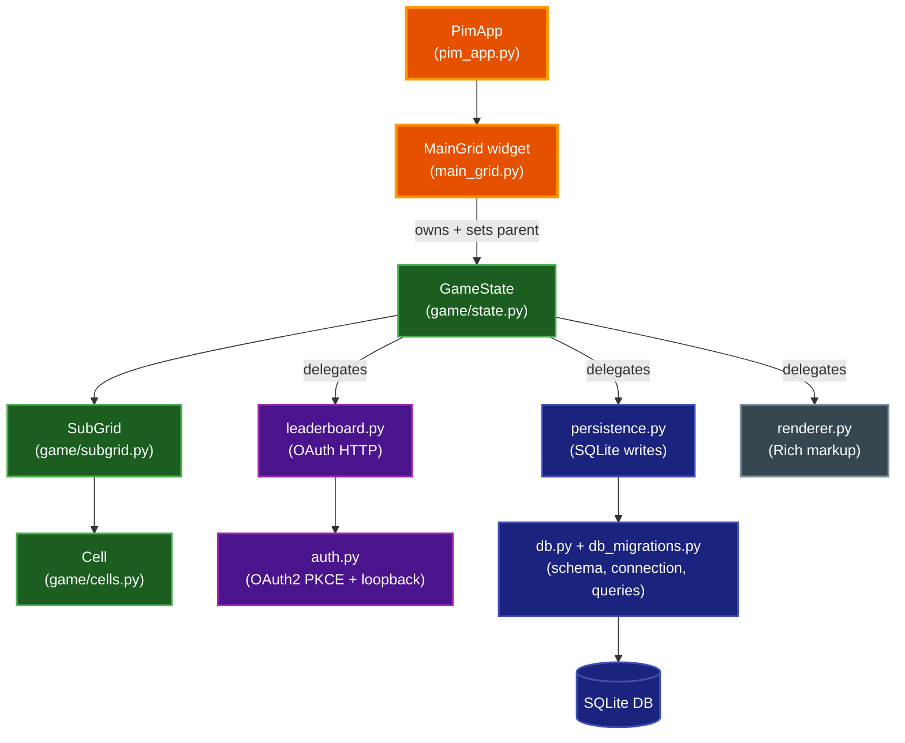
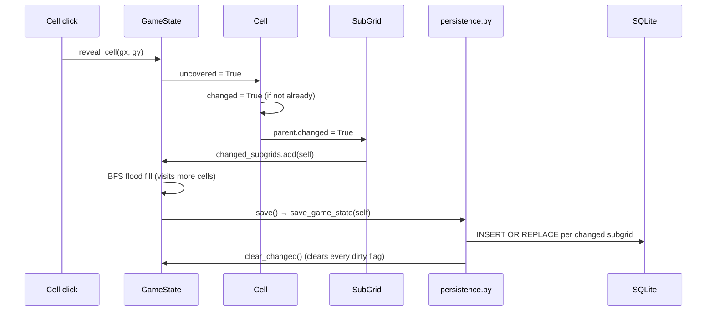
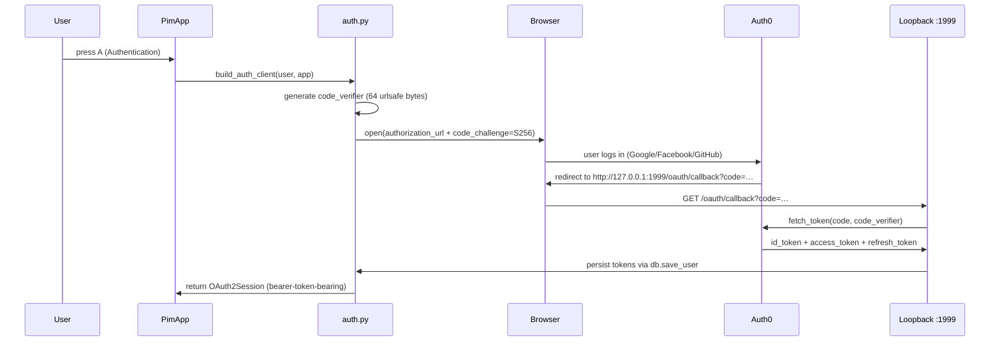

# Architecture: Par Infinite Minesweeper

Par Infinite Minesweeper (`par_infini_sweeper`, command `pim`) is a Python 3.13 Textual TUI that implements an infinite-board minesweeper. The board is composed of 8×8 subgrids generated on demand, the player's progress is persisted incrementally to SQLite, and completed games can be uploaded to an OAuth2-protected internet leaderboard.

This document explains the module layout, the data model, the SQLite schema and migration story, the OAuth2 flow, and where the model and UI are coupled. It is the right starting point before changing anything in `src/par_infini_sweeper/`.

## Table of Contents

- [Context](#context)
- [Module Layout](#module-layout)
- [Data Model](#data-model)
- [Infinite-Board Generation](#infinite-board-generation)
- [Incremental Save](#incremental-save)
- [SQLite Schema and Migrations](#sqlite-schema-and-migrations)
- [OAuth2 / Auth0 Flow](#oauth2--auth0-flow)
- [Rendering](#rendering)
- [Model ↔ UI Coupling](#model--ui-coupling)
- [Where to Start Reading](#where-to-start-reading)
- [Related Documentation](#related-documentation)

## Context

The project was refactored (audit issue ARC-004) from a single 865-LOC `data_structures.py` that mixed game logic, persistence, OAuth, and rendering into four decomposed modules plus a pure `game/` package. The goal of that refactor was to make the model testable without SQLite, Auth0, or a Textual widget — and to give each cross-cutting concern a single owner. The current layout reflects that split.

## Module Layout

```text
src/par_infini_sweeper/
├── __main__.py           # CLI entry (typer) — pim command, --server, env bootstrap
├── __init__.py           # Package metadata only (no import-time side effects)
├── pim_app.py            # Textual App subclass — keybindings, dialogs, mount
├── main_grid.py          # The board widget (mouse → cell coords, rendering loop)
├── messages.py           # Textual Message types posted by auth/web server
├── enums.py              # StrEnum: GameDifficulty, GameMode
├── models.py             # Pydantic DTOs for leaderboard API + validate_nickname
├── utils.py              # format_duration and other pure helpers
├── dialogs/              # Textual modal screens (login, highscore, theme, …)
├── pim.tcss              # Textual CSS
├── help.md               # In-app help content
│
├── game/                 # Pure model (no I/O, no Textual import in cells/subgrid/types)
│   ├── cells.py          # Cell: a single tile (mine/marked/uncovered/highlighted)
│   ├── subgrid.py        # SubGrid: an 8×8 tile of Cells + generation logic
│   ├── state.py          # GameState: orchestrates reveal/flag/highlight + delegates I/O
│   └── types.py          # GridPos tuple alias, mine_counts, difficulty_mult tables
│
├── persistence.py        # SQLite save / load / save_score / save_user (model side)
├── leaderboard.py        # OAuth-protected HTTP: post_internet_score, change_internet_nickname
├── renderer.py           # Rich markup emission: render_cell + count_to_color table
├── auth.py               # OAuth2/Auth0 PKCE flow + loopback callback server
├── db.py                 # SQLite connection, init_db, get_user, get_highscores, save_user
├── db_migrations.py      # Forward-only schema migrations (legacy → 1.0 → 1.1)
└── data_structures.py    # 33-LOC re-export shim for backward compatibility
```

The dependency graph between the decomposed modules is acyclic at runtime: `game.state` imports `persistence`, `leaderboard`, and `renderer`, and each of those three only imports `game.state` under `TYPE_CHECKING` so the import edge does not form a cycle.



## Data Model

Three model classes form a strict containment hierarchy:

- **`GameState`** (`game/state.py`) — the root. Owns the `subgrids: dict[GridPos, SubGrid]`, the current `difficulty` / `theme` / `offset` / `score`, the cached `auth_client`, the `highlighted_cells` and `changed_subgrids` sets, and the `user: dict[str, Any]` row (which carries OAuth tokens, prefs, and the active `game` row).
- **`SubGrid`** (`game/subgrid.py`) — an 8×8 tile of `Cell`s. Knows its `pos: GridPos` (its `(subgrid_x, subgrid_y)` coordinate in the infinite grid) and a `solved: bool` flag.
- **`Cell`** (`game/cells.py`) — a single tile. Carries `is_mine`, `marked`, `uncovered`, `highlighted`, and a `changed` dirty flag.

Coordinates are **global cell coordinates** (`gx`, `gy`); a cell's subgrid is `(gx // 8, gy // 8)` and its local position inside that subgrid is `(gx % 8, gy % 8)`. The board scrolls in whole-cell units and subgrids are allocated lazily as the player expands into new regions.

Each model has explicit `to_dict` / `from_dict` serialization using `orjson`. The round-trip is the persistence boundary (see [Incremental Save](#incremental-save)).

## Infinite-Board Generation

`SubGrid.generate_cells(difficulty)` (`game/subgrid.py`) builds a fresh 8×8 grid by sampling `mine_counts[difficulty]` mine positions from the 64 cells with `random.sample`:

| Difficulty | Mines per 8×8 subgrid |
|---|---|
| Easy | 8 |
| Medium | 12 |
| Hard | 16 |

Subgrids are allocated on demand by `GameState.global_to_cell(gx, gy, create_if_needed=True)`: when the player expands the flood fill or flags a cell at a coordinate whose subgrid does not yet exist, the subgrid is generated, added to `self.subgrids`, and marked `changed = True` so it will be persisted on the next save.

The **first-click safety rule** is implemented in `GameState.reveal_cell`: on the entry call (`depth == 0`), if the clicked cell is a mine, the mine is relocated to the first neighbouring non-mine cell (`_relocate_first_click_mine`), and the `first_click` flag is cleared **before** the flood fill starts so mines encountered during expansion are treated as real mine hits, not silently relocated. The flood fill itself is an iterative BFS (`_flood_fill_reveal`) with a visited set as the termination guarantee and `MAX_REVEAL_ITERATIONS = 250` as a safety bound against pathological/corrupted inputs.

## Incremental Save

Save performance matters because the game saves on every cell click. The design uses **dirty-flag propagation** so only changed subgrids are written:

1. A mutation on a `Cell` (e.g. `cell.uncovered = True`) sets `cell.changed = True`, which propagates up through `Cell.changed.setter` to set `cell.parent.changed = True`.
2. `SubGrid.changed.setter` adds itself to `state.changed_subgrids: set[SubGrid]`.
3. On `GameState.save()`, `persistence.save_game_state(state)` upserts **only** the subgrids in `state.changed_subgrids`, then calls `state.clear_changed()` to clear every flag.

The subgrid payload is `SubGrid.to_dict()` serialized with `orjson` and stored in the `grids` table as a JSON blob keyed by `(game_id, user_id, sub_grid_id)`. `INSERT OR REPLACE` makes the upsert idempotent.

`GameState.load()` is the reverse: it calls `persistence.fetch_saved_subgrids(conn, game_id, user_id)`, which yields `(coords, sg_data)` tuples, and `GameState` runs `SubGrid.from_dict` itself to keep the persistence↔model edge non-circular. `from_dict` also re-derives the `solved` flag from the cell state if the stored row predates the `solved` column.



## SQLite Schema and Migrations

The schema lives in `db.py` (creation) and `db_migrations.py` (forward-only migrations). Five tables:

| Table | Purpose |
|---|---|
| `pim_db_info` | Single-row `(version)` — gates migration. Currently `1.1`. |
| `users` | Identity, nickname, and OAuth tokens (`id_token`, `access_token`, `refresh_token`, `expires_at`). |
| `user_prefs` | Per-user theme + difficulty (CHECK-constrained to `easy`/`medium`/`hard`). |
| `games` | One row per game; carries `mode`, `game_over`, `duration`, `board_offset`. |
| `highscores` | Per-game score rows. `ORDER BY score DESC, created_ts DESC LIMIT 10` for the top-10 view. |
| `grids` | The infinite board — `(game_id, user_id, sub_grid_id)` primary key with `grid_data` JSON blob. |

The migration story is **forward-only**, gated by `pim_db_info.version`:

- **Legacy pre-XDG DB** (no `pim_db_info` table) → `migrate_legacy_db(conn)`. Adds `ON DELETE CASCADE` to foreign keys by table-rebuild, adds `created_ts` / `game_mode` columns, then implicitly becomes `1.0`.
- **`1.0`** → `migrate_db_to_1_1(conn)`. Renames `games.play_duration` → `duration` and `games.game_mode` → `mode`, adds `users.net_nickname` / `id_token` / `access_token` / `refresh_token` / `expires_at`, then writes `version = '1.1'`.
- **`1.1`** — current. No-op.

There is **no downgrade path** — migrations only move forward. The DB lives at `xdg_data_home() / "pim" / "game_data.sqlite"` (with a `.bak` mirror refreshed once per launch via `ensure_backup`). On first launch, the legacy `~/.pim/` folder is renamed to the XDG path by `init_storage()`.

All SQL is parameterized with `?` placeholders — there is no f-string or `%` SQL anywhere in the codebase.

## OAuth2 / Auth0 Flow

`auth.py` implements the OAuth2 Authorization Code flow with PKCE (RFC 7636) against an Auth0 tenant. PKCE is mandatory because this is a public native/desktop client with no client secret.



Key design points:

- **Loopback callback on port 1999** (`OAUTH_CALLBACK_PORT`). The OS may prompt the user to allow incoming connections on this port — see `docs/TROUBLESHOOTING.md`. `ReusableTCPServer` enables `SO_REUSEADDR` so a previous process leaving the socket in `TIME_WAIT` does not fail the next bind.
- **PKCE**: `code_verifier = secrets.token_urlsafe(64)` is generated once in `start_auth_server` and passed to both `create_authorization_url` (which derives `code_challenge = S256(code_verifier)`) and `fetch_token` (which redeems it).
- **Pinned loopback authority**: `LOOPBACK_AUTHORITY = "127.0.0.1:1999"` is used to build `authorization_response` so the request's `Host` header cannot be reflected into `authlib.parse_authorization_code_response`.
- **Token storage**: tokens are persisted as columns on the `users` table. The DB file and folder are `chmod 0o600` / `0o700` on creation; `refresh_token` is long-lived (`offline_access` scope) and the codebase flags a TODO to move it to the OS keychain.
- **Refresh**: if the cached `access_token` is expired or near-expiry and a `refresh_token` is present, `build_auth_client` transparently calls `client.refresh_token(...)` and persists the new tokens. If refresh fails (OAuth error or transport), auth state is cleared.
- **Env overrides**: `AUTH0_DOMAIN` and `AUTH0_CLIENT_ID` can be overridden for local development against a test tenant. If `AUTH0_CLIENT_ID` is unset, `warn_if_default_auth0_client_id()` prints a one-time stderr warning that the production tenant is in use.

## Rendering

`renderer.py` exposes a single free function, `render_cell(state, gx, gy) -> str`, that returns the Rich markup string for one cell. The `count_to_color` table maps adjacent-mine counts to hex colors. The legacy `GameState.get_cell_representation` method is now a one-line delegate to this function so call sites are unchanged.

Background is a checker pattern derived from `(sg_coord[0] + sg_coord[1]) % 2`; the subgrid under the mouse is highlighted yellow when `state.highlighted_subgrid` is on. The renderer reaches into `state` for xray mode, mouse position, and solved/highlighted status — it is a pure projection of model state, with no side effects.

## Model ↔ UI Coupling

The model and UI are **intentionally coupled** via `GameState.parent: Widget | None`. Several `GameState` methods (`reveal_cell`, `toggle_mark`, `highlight_neighbors`, `reveal_surround`, `update_mouse_info`) call `self.parent.notify(...)` and `self.parent.refresh()` directly to drive the UI after a mutation.

This is a known design debt (audit issue ARC-005), preserved deliberately through the Phase 3b decomposition because:

- Replacing it with Textual `Message`s requires a UI integration-test harness that does not yet exist.
- The decomposition already extracted persistence, leaderboard, and rendering out of the model, which was the larger win for testability.
- A future Message-based decoupling can land incrementally: each `self.parent.X(...)` call site is a candidate `Message` subtype.

Until that lands, the model is only runnable inside a Textual widget (tests construct a lightweight `MainGrid` stand-in or pass `parent=None` where the call site guards it). The `mouse_to_global_grid_coords` and `update_mouse_info` methods were already migrated to take explicit `(x, y, shift, ctrl)` parameters rather than a `MouseEvent`, so the model no longer reaches into Textual event internals.

## Where to Start Reading

- **To understand gameplay**: `game/state.py` — `reveal_cell` (the BFS flood fill and first-click safety), `check_subgrid_solved`, `score`.
- **To understand persistence**: `persistence.py` (the dirty-flag save) + `db.py:get_user` (the row reconstruction).
- **To understand auth**: `auth.py:start_auth_server` (PKCE + loopback) + `auth.py:build_auth_client` (refresh logic).
- **To understand the UI**: `pim_app.py` (keybindings, mount) → `main_grid.py` (mouse handling, render loop) → `dialogs/`.
- **To understand the schema**: `db.py:init_db` (CREATE TABLE) + `db_migrations.py` (forward migrations).
- **For release workflow**: `docs/RELEASE.md`.

## Related Documentation

- [README](../README.md) — user-facing overview, controls, scoring.
- [CONTRIBUTING](../CONTRIBUTING.md) — development setup and conventions.
- [Troubleshooting](TROUBLESHOOTING.md) — port-1999 firewall, `--server` exposure, nickname limits.
- [Release pipeline](RELEASE.md) — the 4-stage build → TestPyPI → PyPI → GitHub Release flow.
- [Documentation style guide](DOCUMENTATION_STYLE_GUIDE.md) — formatting and writing conventions.
