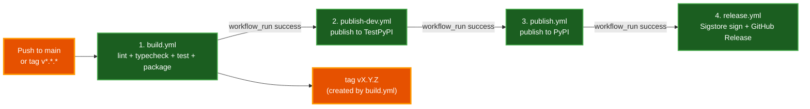

# Release Pipeline

Releases of `par_infini_sweeper` are produced entirely through GitHub Actions CI/CD. There is no manual `twine upload` or local publish step — publishing flows through OIDC trusted publishing with no long-lived PyPI tokens, and the resulting wheel and sdist are signed with Sigstore. This document explains the four-stage pipeline, the trigger sequence, and how to cut a release.

## Table of Contents

- [Pipeline Overview](#pipeline-overview)
- [Stage 1 — Build](#stage-1--build)
- [Stage 2 — Publish to TestPyPI](#stage-2--publish-to-testpypi)
- [Stage 3 — Publish to PyPI](#stage-3--publish-to-pypi)
- [Stage 4 — GitHub Release with Sigstore](#stage-4--github-release-with-sigstore)
- [Cutting a Release](#cutting-a-release)
- [Trust Model and Supply-Chain Controls](#trust-model-and-supply-chain-controls)
- [Operational Notes](#operational-notes)
- [Related Documentation](#related-documentation)

## Pipeline Overview

The pipeline is a four-stage chain triggered by a push to `main`. Each stage fires `workflow_run` on the previous stage's success, so a release is hands-off once the version bump lands on `main`. The stages are defined in `.github/workflows/`:



| Stage | Workflow file | Trigger | Output |
|---|---|---|---|
| 1. Build | `build.yml` | push to `main` or tag `v*.*.*` | `dist/` artifacts cached + uploaded; git tag `vX.Y.Z` created |
| 2. TestPyPI | `publish-dev.yml` | `workflow_run` on Build success, or manual | Package on <https://test.pypi.org/project/par-infini-sweeper/> |
| 3. PyPI | `publish.yml` | `workflow_run` on TestPyPI success, manual, or GitHub Release published | Package on <https://pypi.org/project/par-infini-sweeper/> |
| 4. Release | `release.yml` | `workflow_run` on PyPI success, or manual | GitHub Release with Sigstore signatures |

All stages run on `ubuntu-latest` with Python 3.13 and install dependencies via `uv sync --all-groups` (using `astral-sh/setup-uv@v5` with caching enabled).

## Stage 1 — Build

File: `.github/workflows/build.yml`

Trigger: push to `main` or push of a tag matching `v*.*.*`.

Steps:

1. Checkout, install uv, set up Python 3.13, run `uv sync --all-groups`.
2. **Lint and Typecheck** — runs `make checkall`, which is `format-check` + `lint-check` + `typecheck` + `test`. This is the CI-safe variant — it does not mutate files.
3. **Test** — `make test` (redundant with step 2 since `checkall` includes test, but kept as an explicit gate).
4. **Package** — `make package-all`, which runs `python -m build` to produce both wheel and sdist in `dist/`.
5. **Cache build artifacts** — keyed on `pyproject.toml` hash + commit SHA, so downstream stages restore the exact binaries this build produced.
6. **Upload artifacts** — `actions/upload-artifact@v4` publishes `dist/` under the name `python-package-distributions-ubuntu-latest-3.13-x64`.

The `tag-version` job (only on `main` pushes, not tag pushes) reads `__version__` from `src/par_infini_sweeper/__init__.py`, checks whether a matching `vX.Y.Z` tag already exists, deletes it if so (so re-runs of the same version overwrite), and pushes `git tag -a vX.Y.Z`. Tag deletion uses `secrets.GITHUB_TOKEN` with `contents: write`. On failure, the tag is cleaned up locally and remotely.

## Stage 2 — Publish to TestPyPI

File: `.github/workflows/publish-dev.yml`

Trigger: `workflow_run` on successful completion of "Build and Test 🐍 distribution 📦", or `workflow_dispatch` (manual).

Steps:

1. Checkout, install uv, Python 3.13, `uv sync --all-groups`.
2. Read `__version__` from `__init__.py`.
3. Restore the cached `dist/` from Stage 1.
4. If the cache missed, rebuild via `make package-all`.
5. Publish to TestPyPI with `pypa/gh-action-pypi-publish@release/v1`, passing `repository-url: https://test.pypi.org/legacy/` and `skip-existing: true`.
6. Optional Discord notification via webhook (`continue-on-error: true`).

`id-token: write` is granted so the action can use OIDC trusted publishing against TestPyPI — no API token is stored as a repository secret.

**Environment:** GitHub environment named `testpypi`, with the TestPyPI project URL recorded as the environment URL.

## Stage 3 — Publish to PyPI

File: `.github/workflows/publish.yml`

Trigger: `workflow_run` on successful completion of "Publish 🐍 📦 to TestPyPI", or `workflow_dispatch`, or a published GitHub Release.

Steps mirror Stage 2 but target production PyPI: same cache restore + rebuild-on-miss logic, then `pypa/gh-action-pypi-publish@release/v1` (no `repository-url` override — defaults to PyPI production).

**Environment:** GitHub environment named `pypi`, with the PyPI project URL recorded as the environment URL.

OIDC trusted publishing is configured on the production PyPI project for this repository, so no `PYPI_API_TOKEN` secret exists anywhere in the repo.

## Stage 4 — GitHub Release with Sigstore

File: `.github/workflows/release.yml`

Trigger: `workflow_run` on successful completion of "Publish 🐍 📦 to PyPI", or `workflow_dispatch`.

Steps:

1. Checkout, install uv, Python 3.13, `uv sync --all-groups`.
2. Read `__version__` from `__init__.py`.
3. Restore the cached `dist/` from Stage 1.
4. If the cache missed, rebuild via `make package-all`.
5. **Sign with Sigstore** — `sigstore/gh-action-sigstore-python@v3.0.0` signs every `./dist/*.tar.gz` and `./dist/*.whl`. Signatures (`.sigstore` bundles) are produced alongside the artifacts.
6. **Create GitHub Release** — `gh release create release-vX.Y.Z --generate-notes --latest`. Notes are auto-generated from commit history since the previous release.
7. **Upload signatures** — `gh release upload release-vX.Y.Z dist/**` attaches the wheels, sdists, and their `.sigstore` signature bundles to the GitHub Release.
8. Discord notification via webhook.

On failure, the GitHub Release is deleted and `dist/` is cleaned up so a re-run starts clean.

Permissions: `contents: write` (to create the release and upload assets) and `id-token: write` (for Sigstore's fulcio-CA-backed signing).

## Cutting a Release

A release is initiated by bumping the version in `src/par_infini_sweeper/__init__.py` and merging the bump to `main`:

```python
# src/par_infini_sweeper/__init__.py
__version__ = "0.3.9"
```

The pipeline then runs end-to-end without further intervention:

1. The push to `main` triggers `build.yml`.
2. `build.yml`'s `tag-version` job creates and pushes `git tag v0.3.9`.
3. The four stages chain on `workflow_run` triggers.
4. When all four complete: a new `release-v0.3.9` GitHub Release exists with signed artifacts, the package is live on PyPI, and TestPyPI has a parallel copy.

To verify the release landed:

```bash
uv tool install --upgrade par_infini_sweeper
pim --version
```

The displayed version should match the bumped `__version__`.

### Manual re-trigger

Every stage except Build also accepts `workflow_dispatch`, so a failed downstream stage can be re-run from the GitHub Actions UI without re-running the whole chain. This is useful when, for example, TestPyPI was briefly down and Stage 2 failed while Stage 1's artifacts are still cached.

### Releasing the same version twice

If you push a new commit with the same `__version__` value (e.g. to fix a release bug), `build.yml`'s `tag-version` job will **delete the existing tag** locally and remotely, then re-create and re-push it. The downstream stages re-publish to TestPyPI (with `skip-existing: true` so TestPyPI does not error on duplicate version), but **PyPI does not allow re-uploading the same version** — you must bump `__version__` for a corrected release.

## Trust Model and Supply-Chain Controls

| Control | Where |
|---|---|
| **OIDC trusted publishing** (no long-lived PyPI tokens) | Stages 2 and 3 use `id-token: write` + PyPI's trusted publisher configuration for this repo. |
| **Sigstore signing** of wheels and sdists | Stage 4 signs every artifact with `sigstore/gh-action-sigstore-python@v3.0.0`. Consumers can `pip install sigstore && sigstore verify github --cert-identity paulrobello@users.noreply.github.com par_infini_sweeper-*.whl`. |
| **Build artifact caching** | The `dist/` produced in Stage 1 is what Stages 2–4 publish. Downstream stages only rebuild on a cache miss (with `make package-all`). |
| **Pre-publish gates** | Stage 1 runs `make checkall` (format-check + lint-check + typecheck + test) before packaging — a failing gate stops the chain before anything reaches TestPyPI. |
| **Secret scanning** | `.pre-commit-config.yaml` runs `gitleaks` + `detect-private-key` on every commit. |
| **GitHub environments** | `testpypi` and `pypi` environments gate their respective stages with the project URL recorded for review. |

Consumers who want to verify a downloaded wheel came from this repo's CI can use the Sigstore signature attached to the matching GitHub Release under `release-vX.Y.Z`.

## Operational Notes

- **All stages share one source of truth for the version** — `src/par_infini_sweeper/__init__.py:__version__`. The version is read into `$VERSION` at the start of every stage and used for tag creation, environment URLs, and the GitHub Release title.
- **`uv.lock` is committed** and tracks all dependencies (runtime + dev). `uv sync --all-groups` installs both. A dependency change requires regenerating the lock (`make uv-lock`) in the same PR.
- **No local publish commands exist.** The Makefile has `package`, `spackage`, and `package-all` for building locally, but no `publish` target — publishing happens exclusively through CI per project policy.
- **Discord notifications** are best-effort (`continue-on-error: true`); a failed webhook does not fail the release.
- **Python version is pinned to 3.13** in every workflow. The project's `requires-python` is `>=3.11`, but CI does not currently matrix-test across 3.11/3.12 (audit issue ARC-025).

## Related Documentation

- [Architecture](ARCHITECTURE.md) — module layout, schema, OAuth flow.
- [Contributing](../CONTRIBUTING.md) — development setup and PR process.
- [Troubleshooting](TROUBLESHOOTING.md) — common release / install failures.
- Workflow files: `.github/workflows/{build,publish-dev,publish,release}.yml`.
